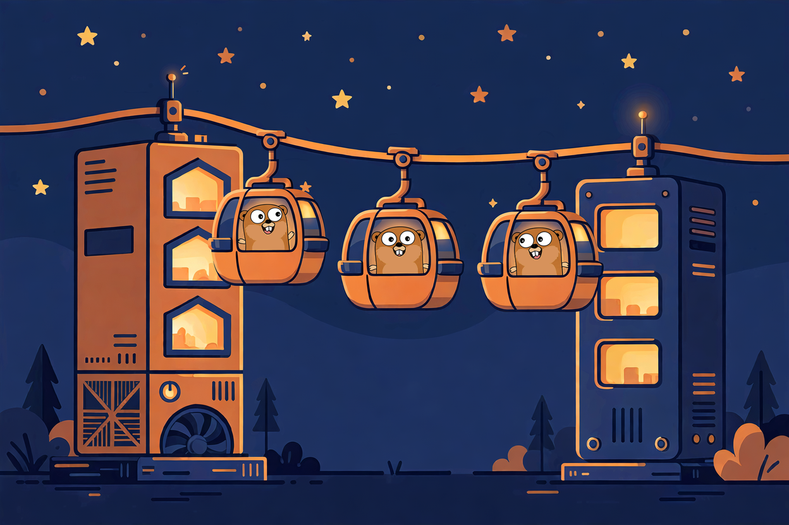

<p align="center">
  
</p>

<h1 align="center">gondola</h1>

<p align="center">
  <em>A gondola carries its passengers between stations and stops only where<br>
  it's sent — this one carries requests between machines.</em><br>
  <strong>G</strong>o-<strong>O</strong>rchestrated <strong>N</strong>ode <strong>D</strong>ispatch <strong>O</strong>ver <strong>L</strong>ocal <strong>A</strong>rea.
</p>

<p align="center">
  
  
  
</p>

A mode-aware routing proxy for **multiple Ollama machines**, written in
Go as a single static binary. Point your agent or app at one endpoint;
the dispatcher decides, per request, which PC/GPU serves it — waking that
machine over Wake-on-LAN when the active mode allows it.

A **mode** is a named assignment of machines to jobs: `home` might keep
everything on the always-on server and never wake the gaming PC, `away`
might prefer the big GPU, `test` pins unassigned requests to one machine
and model so benchmarks stay honest (roles still route), and `dev`
prefers the strong machine but expires back to `home` after a few hours.
Modes are configuration, not code — define your own in `dispatcher.yaml`.

- **Modes are policy** — which machines serve, which are ignored, who may be woken, optional TTLs that fall back to a default mode
- **Roles, not just models** — clients ask for `brain`, `heavy`, `coder`, `utility`; each role can name a different model per machine
- **Pass-through, always** — an explicitly named model is never silently substituted (see below)
- **Wake-on-LAN** — asleep machines are woken when the mode sends them work
- **Discovery** — `gondola discover` scans your LAN and writes a starter config
- **A web console** — modes, live activity, and structured settings at `/ui`
- **One static binary** — no runtime dependencies; Ollama- and OpenAI-compatible endpoints

Full design: [SPEC.md](SPEC.md). The Python prototype this replaces
lives in [prototype-python/](prototype-python/).

## Console

A running gondola serves a small web console at `/ui`: switch modes,
watch backend health, see what each mode actually uses or ignores,
review the most recent routing decisions (what was delegated where,
and whether a rewrite applied), and change settings through
structured controls — including renaming a device, which rewrites
every mode and role that references it. Settings saves are validated
through the real loader before they touch disk, keep a `.bak` of the
previous file, and apply on restart; a raw config editor remains
available behind an Advanced section as an escape hatch. When an
admin token is configured, the console's data endpoints require it;
the token itself is never shown in the editor.

## Pass-through guarantee

Gondola never silently substitutes models. Name a model and that exact
model is requested from the serving backend; if the backend doesn't
have it, you get its 404 — not a different model. The only rewrites are
the deliberate ones: role names, bare backend aliases, model-less
requests, and pin modes. Each one is recorded in the activity log.

## Quick start

```bash
./gondola discover        # scan the LAN, write a starter dispatcher.yaml
```

or by hand:

```bash
cp dispatcher.example.yaml dispatcher.yaml   # your machines, models, modes
go build -o gondola .
./gondola serve --config dispatcher.yaml
```

Then point any Ollama or OpenAI-compatible client at
`http://localhost:11435` and switch modes with the same binary:

```bash
./gondola mode          # show the active mode
./gondola mode dev      # switch
./gondola modes         # which PC/GPU each mode invokes
./gondola health
```

Or over HTTP: `GET|POST /mode`, `GET /modes`, `GET /health`.

## Endpoints

Ollama-native: `POST /api/chat`, `POST /api/generate`, `POST /api/show`,
`GET /api/ps`, `GET /api/tags` (merged from all reachable backends,
without waking any), `GET /api/version`. OpenAI-compatible:
`POST /v1/chat/completions`, `GET /v1/models` (both backends' defaults,
backend aliases, and all role names). Streaming passes through as-is.

Roles let clients ask for a job instead of a model — `brain`, `heavy`,
`coder`, `utility` by default — and the mode decides which machine
serves the role.

## Tests

```bash
go test ./...
```

The routing core is pure, so the full routing matrix — including the
pass-through guarantee — is covered without any Ollama backend running.

## License

MIT
